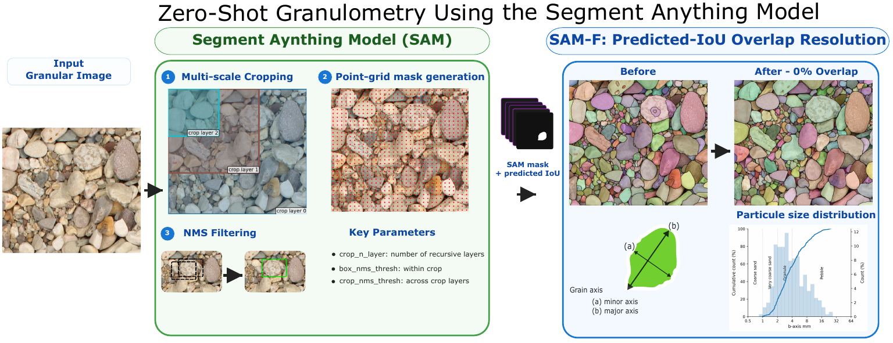

# Zero-Shot Granulometry Using the Segment Anything Model

<p align="center">
  
</p>

*Graphical abstract based on image from the Deep Granulometry dataset.*

## Overview

This repository provides the Python implementation of **Zero-Shot Granulometry Using the Segment Anything Model (SAM)**, a methodology for automatic grain segmentation and particle size distribution (PSD) estimation from geological images.

The proposed approach combines the pretrained SAM model with a confidence-guided filtering strategy (SAM-F) to obtain grain segmentations, enabling the extraction of grain morphological properties and the estimation of particle size distributions without additional model training or manual annotations.

## Quick Start

Follow these steps to run a first test of the code.

### 1. Clone the repository

```bash
git clone https://github.com/Mirnacharif/Zero-Shot-Granulometry.git
cd Zero-Shot-Granulometry
```

### 2. Install dependencies

Install the required Python packages:

```bash
pip install -r requirements.txt
```

### 3. Download the pretrained SAM model

Download the SAM ViT-H checkpoint:

**Checkpoint:** `sam_vit_h_4b8939.pth`

Download it from the official [ SAM model checkpoints](https://github.com/facebookresearch/segment-anything#model-checkpoints) page and place the file in the `models/` directory.

### 4. Run a Quick Test

The notebook `notebooks/02_SAM-F_predictions.ipynb` provides a quick example of the grain segmentation pipeline using SAM-F.

It demonstrates how to load the model, generate grain masks, apply SAM-F filtering, and visualize the segmentation results.

To run the test, launch Jupyter from the repository root:

```bash
jupyter notebook
```

Open `02_SAM-F_predictions.ipynb` and execute the cells sequentially.

**Note:** Ensure that the required dependencies are installed and the pretrained SAM checkpoint is available in the `models/` directory. Segmentation results are saved in the output directory.

## How to Use the Code

The repository includes four Jupyter notebooks covering the main steps of the proposed methodology:

1. **Parameter analysis** — `01_SAM-F_parameter_effects.ipynb`: Investigate the influence of SAM and SAM-F parameters on segmentation results to guide parameter selection.
2. **Grain segmentation** — `02_SAM-F_predictions.ipynb`: Apply the segmentation pipeline using the selected parameters and generate grain masks.
3. **Grain characterization and particle size distribution (PSD) analysis** — `03_grain_size_distribution_analysis.ipynb`: Extract morphological properties of the segmented grains and compute PSD curves in millimetres using the image scale (mm/pixel).
4. **Segmentation evaluation** — `04_evaluation.ipynb`: Optionally evaluate segmentation performance using AP-based metrics when ground-truth annotations are available.

All notebooks are available in the `notebooks/` directory.

## Methodology

The proposed confidence-guided filtering strategy (SAM-F) selects relevant masks generated by SAM using appropriately tuned parameters and reduces overlaps to obtain non-overlapping grain segmentations for granulometric analysis.

## Models

The experiments primarily use the pretrained **SAM ViT-H** model without fine-tuning.

The official SAM implementation and pretrained checkpoints are provided by Meta AI:

- [Segment Anything – Meta AI](https://github.com/facebookresearch/segment-anything)

## Datasets

This study uses images from two publicly available datasets and one dataset provided by BRGM:

**1. IG2 Dataset**

The IG2 dataset, including images and annotations, is available from [Zenodo](https://doi.org/10.5281/zenodo.17866827).
One image from the ImageGrains 2.0 dataset (Mair et al., 2025) is included in the repository as a sample image to test the grain segmentation pipeline. The dataset is available under the Creative Commons Attribution 4.0 International licence (CC BY 4.0).

**2. Deep Granulometry Dataset**

Two images were used from the publicly available Deep Granulometry dataset: one from the Coarse Aggregate Data subset and one from the Fine Aggregate Data subset.

Available at: [Deep Granulometry Dataset](https://data.uni-hannover.de/dataset/deep-granulometry).

**3. BRGM Dataset**

The geological images provided by BRGM may be available upon request, subject to BRGM's permission.

The two public datasets are not redistributed in this repository, except for the sample image mentioned above. Please download them from their respective original sources.

## Citation

If you use this code in your research, please cite the associated paper:

*Zero-Shot Granulometry Using the Segment Anything Model.*

## Acknowledgements

This work uses the Segment Anything Model developed by Meta AI.

## Licence

The source code in this repository is released under the MIT Licence.

Third-party datasets and images remain subject to their respective licences and terms of use.